<div align="center">

# HomeMind TaskFlow

**말이 끝나기 전에 준비하고, 상황을 보고 먼저 제안하는 온디바이스 AI 스마트홈**

제24회 임베디드SW경진대회 · 스마트 가전 부문 · 팀 **PrivateFlowNest**

      

**시연 동영상: 〈유튜브 링크〉**

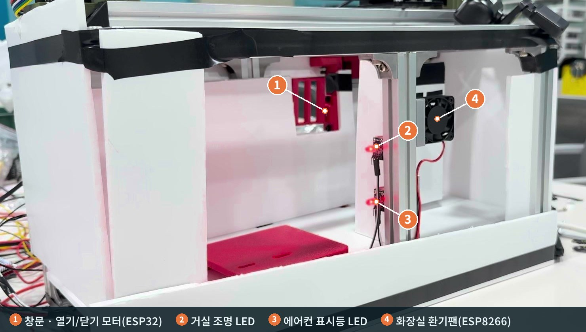

</div>

<br>

## 한눈에 보기

> "아 좀 덥네…" 같은 혼잣말도 알아듣고, 회의가 시작되면 알아서 조용해지는 집. 그런데 AI는 **제안만** 하고, 실행은 **정책 검증과 사람의 승인**을 거칩니다. 음성·영상 원본은 **집 밖으로 나가지 않습니다.**

- **말 중간 준비** · 말하는 도중의 부분 발화로 대상 기기를 7인치 화면에 미리 표시하고, 말이 끝나면 실행합니다. 부분 발화만으로는 실행하지 않습니다.
- **숨은 의도 이해** · 규칙에 없는 말은 Pi 5의 EXAONE이 의도를 해석해 **제안**합니다. 7인치 화면이나 휴대폰에서 승인해야 실행됩니다.
- **상황 인지** · 소리 상황(YAMNet)과 카메라 위치 구역을 합쳐 회의 중임을 알아채면 조용 모드를 켭니다. "상황이 달라요" 한 번이면 바로 해제됩니다.
- **안전한 실행** · Pi 4 core가 장치·출처·정책을 확인합니다. 현관문은 집 안 7인치 화면에서만 승인되고, ESP는 만료·중복 명령을 거절하고 ACK로 완료를 알립니다.
- **Edge First** · 음성 인식·LLM·영상 처리가 모두 집 안 Pi에서 동작합니다. 인터넷이 끊겨도 그대로 쓸 수 있습니다.

## 실제 모형에서

<table>
<tr>
<td width="50%" align="center">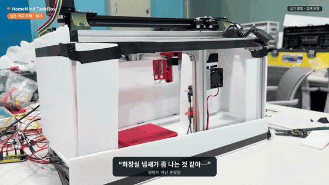<br><sub><b>"화장실 냄새가 좀 나는 것 같아…"</b> → EXAONE이 환기로 해석 → 환기팬 켜짐<br>(EXAONE 처리 22초는 잘라냄)</sub></td>
<td width="50%" align="center">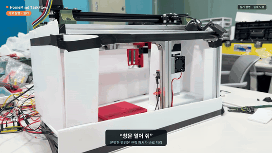<br><sub><b>"창문 열어 줘"</b> → 규칙 파서가 바로 처리 → ESP32 모터가 창문을 엶<br>(대기 5초는 잘라냄)</sub></td>
</tr>
</table>

## 화면

7인치 터치 UI(Pi 5, Flutter)와 휴대폰 앱(Android, Flutter)입니다. 실제 앱 코드를 시나리오 데이터로 PC에서 그린 화면입니다.

<table>
<tr>
<td width="50%">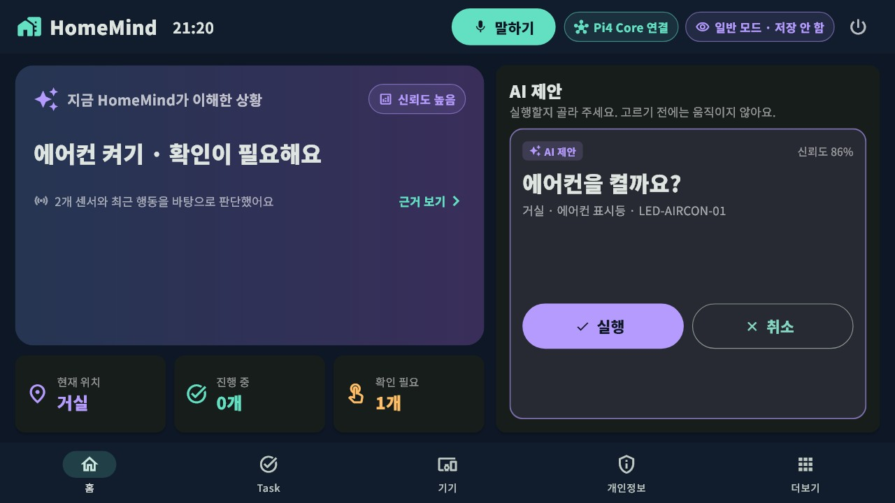<br><sub>EXAONE의 제안: "에어컨을 켤까요?" · 고르기 전에는 움직이지 않음</sub></td>
<td width="50%">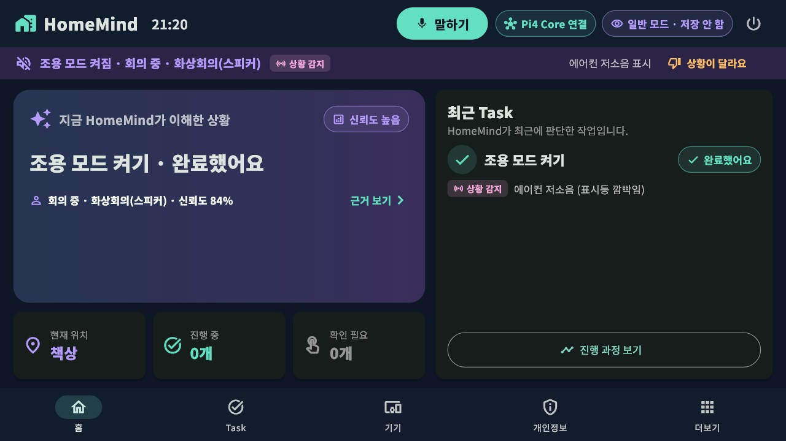<br><sub>회의 감지 → 조용 모드 · "상황이 달라요"로 바로 해제</sub></td>
</tr>
<tr>
<td>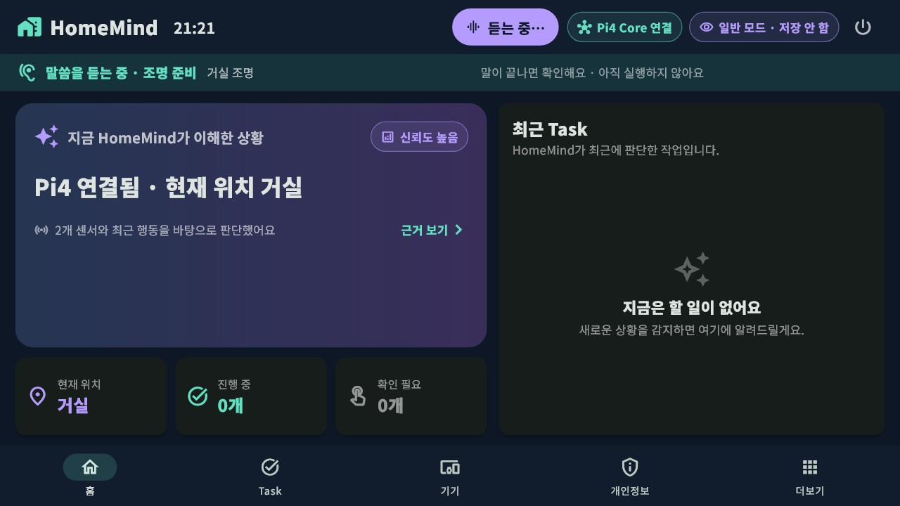<br><sub>말하는 도중 "조명 준비" · 아직 실행하지 않음</sub></td>
<td>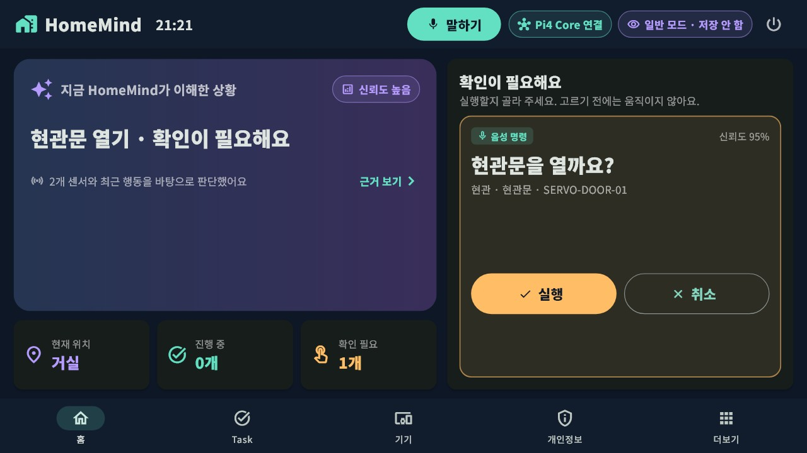<br><sub>현관문 열기는 집 안 7인치 화면에서만 승인</sub></td>
</tr>
</table>

<p align="center">
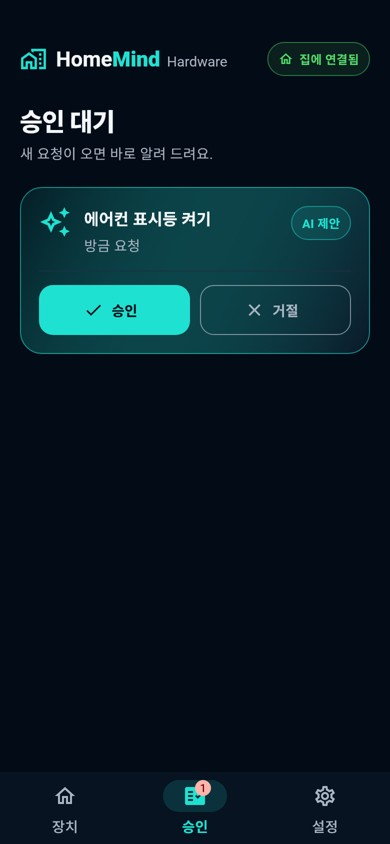
&nbsp;&nbsp;
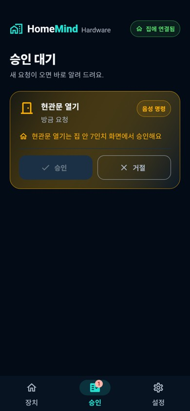
<br><sub>휴대폰 승인 대기: AI 제안은 휴대폰에서도 승인 · 현관문은 승인 버튼이 꺼져 있음</sub>
</p>

## 시스템 구성

<p align="center">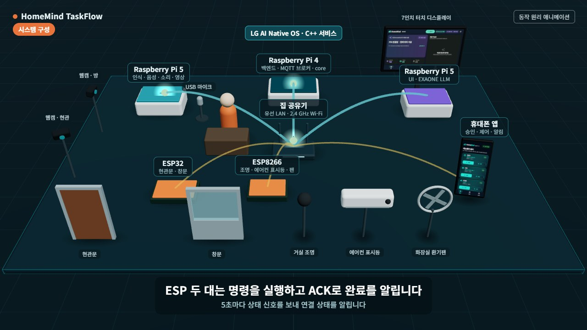</p>

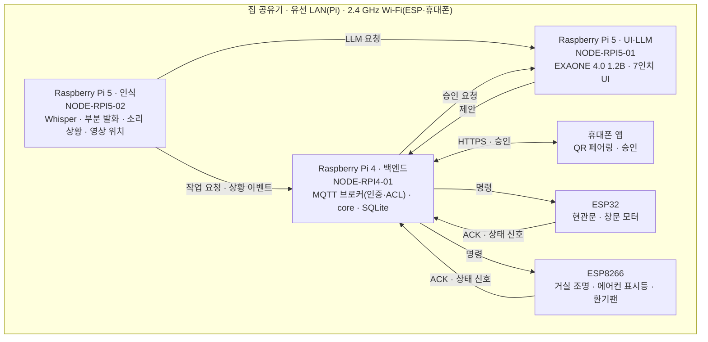

| 기기 | 역할 | 코드 |
|---|---|---|
| Raspberry Pi 4 (NODE-RPI4-01) | MQTT 브로커(인증·ACL), core(검증·정책·작업), SQLite, 휴대폰 API | [`team/homemind-core-ui-2026-10-20/src`](team/homemind-core-ui-2026-10-20/src), [`native/services/homemind-mobile-api`](native/services/homemind-mobile-api) |
| Raspberry Pi 5 (NODE-RPI5-02) | 음성 인식(Whisper), 부분 발화, 소리 상황, 영상 위치, 상황 융합 | [`native/services/homemind-perception`](native/services/homemind-perception), [`homemind-vision`](native/services/homemind-vision), [`native/libs`](native/libs) |
| Raspberry Pi 5 (NODE-RPI5-01) | EXAONE 4.0 1.2B LoRA, 7인치 터치 UI | [`native/services/homemind-llm`](native/services/homemind-llm), [`homemind_flutter_test`](team/homemind-core-ui-2026-10-20/homemind_flutter_test) |
| ESP32 (CTRL-ESP32-ACT-01) | 현관문·창문 열기/닫기 모터 | [`firmware/src/esp32_actuator`](firmware/src/esp32_actuator) |
| ESP8266 (CTRL-ESP8266-LED-01) | 거실 조명 LED, 에어컨 표시등 LED, 화장실 환기팬 | [`firmware/src/esp8266_led`](firmware/src/esp8266_led) |
| 휴대폰 (Android) | QR 페어링, 장치 상태·제어, 승인 요청 알림 | [`team/homemind-application-2026-10-21`](team/homemind-application-2026-10-21) |

### "아 좀 덥네…"가 실행되기까지

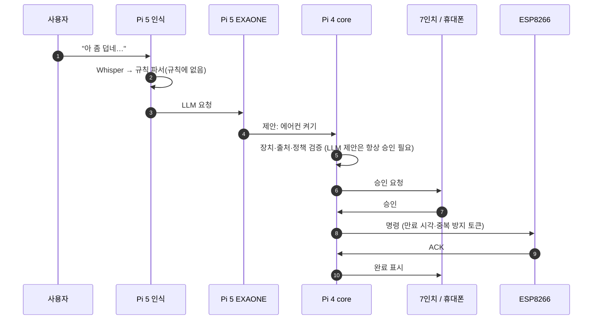

## 실기 확인 결과

PC 시험과 실기(실제 Pi·ESP) 결과를 나눠 적습니다.

| 항목 | 결과 | 구분 |
|---|---|---|
| 음성 인식 지연 (Pi 5, "거실 불 켜줘") | 13.8 s → **3.0 s** (Whisper 설정 조정) | 실기 |
| EXAONE 판단 (Pi 5, "아 좀 덥네" → 에어컨 켜기 제안) | 약 20초 | 실기 |
| 7인치 UI 부팅 자동 시작 · 휴대폰 QR 페어링 · 두 카메라 영상 | 동작 확인 | 실기 |
| 모형에서 음성 명령 → 창문 · 조명 · 에어컨 표시등 · 환기팬 | 동작 확인 (2026-10-27 촬영) | 실기 |
| 메시지 계약 · core 정책 · 승인 만료 · ACL 시험 | 통과 | PC |

## 기술 스택

| 분야 | 사용 |
|---|---|
| 플랫폼 | LG AI Native OS (Pi 5 ×2, Pi 4), Atlas 앱 관리자·Camera1 D-Bus, IPK · systemd |
| 기기 서비스 | C++20 네이티브 서비스(aarch64), Mosquitto MQTT(인증·ACL), SQLite |
| AI | EXAONE 4.0 1.2B LoRA (llama.cpp, Q4_K_M), Whisper small LoRA (whisper.cpp), YAMNet 소리 상황, 부분 발화 분류(ONNX), YOLOX 영상 위치 |
| 화면 | Flutter (7인치 UI: flutter-elinux / 휴대폰: Android) |
| 펌웨어 | Arduino · PlatformIO (ESP32, ESP8266) |
| 개발 | Windows PC(RTX 3090) 학습·빌드, Docker arm64 교차 빌드, JSON Schema 메시지 계약 |

## 폴더

```
contracts/   메시지 계약 pfn.v1 (JSON Schema), 공식 장치 ID · 정책 · 규칙, 계약 검증기
native/      C++ 네이티브 서비스와 라이브러리, IPK 패키징, 시험
team/        Pi 4 core (C++), 7인치 UI (Flutter), 휴대폰 앱 (Flutter)
firmware/    ESP32 · ESP8266 펌웨어 (PlatformIO)
services/    AI 모델 학습 · 평가 코드 (EXAONE LoRA, Whisper, 소리 상황, 부분 발화, 영상 위치, 상황 융합)
deploy/      기기별 설치 스크립트, 서명 · 수집, 설치 리허설
octopus/     XY 이동 장치 (Klipper) 설정
demo/        PC에서 core · 브로커를 띄우는 Docker 구성
docs/        보고서 · 작품소개서 · 시연 동영상 생성 코드, 화면 캡처
```

## 직접 해 보기

```bash
# 메시지 계약 검증
python contracts/validate-contracts.py
python -m unittest discover -s contracts/tests

# PC에서 브로커 + core 실행 (시뮬레이션)
docker compose -f demo/pc/docker-compose.yml up --build

# 펌웨어 PC 단위 시험
cd firmware && pio test -e native
```

기기 설치와 arm64 빌드는 [`native/README.md`](native/README.md), [`deploy/README.md`](deploy/README.md)를 참고하세요.

## 팀 PrivateFlowNest

| 구분 | 이름 | 담당 |
|---|---|---|
| 팀장 | 박영만 | 하드웨어 구성, 펌웨어, 센서·제어 노드 |
| 팀원 | 안형민 | 로컬 AI 추론, 개인화, 사용자 UI |
| 팀원 | 김기원 | 허브 소프트웨어, 엣지 AI 통합, 하드웨어 연동 |
| 팀원 | 박준우 | 기획, 시스템 설계, 문제 정의, 프로젝트 관리 |
| 팀원 | 박정빈 | 모바일 애플리케이션 |

## 공개본에서 뺀 것

- **학습된 모델과 데이터 원본**(EXAONE·Whisper 가중치 등): 용량이 커서 넣지 않았습니다.
- **LG AI Native OS SDK·샘플과 교육 자료**: 배포 권한이 없어 넣지 않았습니다.
- **비밀 값**: MQTT 비밀번호는 `firmware/include/secrets.h`(예시 `secrets.h.example`)와 기기의 설정 파일에만 둡니다. 펌웨어의 Wi-Fi 값(`firmware/include/hm_site_network.h`)은 자리표시입니다.
- 개발 기록 문서와 대회 양식.
